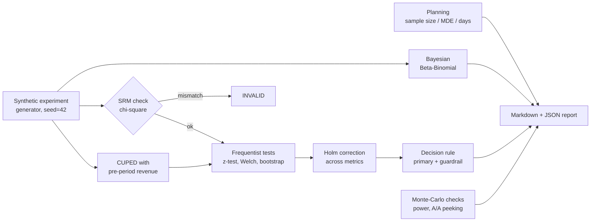

# ab-test-analysis-toolkit

A small, tested Python toolkit that takes an A/B test from **planning** (sample size, MDE, duration) through **analysis** (SRM check, z/Welch tests, CUPED, Bayesian Beta-Binomial, multiple-testing correction) to a **decision report**, and checks its own error rates with Monte-Carlo simulation.

[](https://github.com/SurajKumarrrrr/ab-test-analysis-toolkit/actions/workflows/ci.yml)

## Problem

Product teams run experiments all the time, but the statistics around them often go wrong in ways that look harmless:
underpowered tests, broken traffic splits nobody checks, "peeking" at the dashboard every day, testing many metrics without correction, or reading too much into one segment.
This project shows a clear, reproducible workflow that avoids those traps, using only `numpy`, `scipy` and `pandas`, so every formula is visible and tested.

## Approach



| Module | What it does |
|---|---|
| `power.py` | Sample size for proportions (Fleiss formula) and means, power for a given n, MDE by root-finding, test duration |
| `frequentist.py` | Two-proportion z-test (pooled SE for the test, unpooled for the CI), Welch t-test, delta-method CI for **relative** lift, bootstrap CI, SRM chi-square test, Holm / Benjamini-Hochberg |
| `bayesian.py` | Beta-Binomial posterior, P(B > A), expected loss of each decision, credible interval for the lift, expected-loss ship rule |
| `cuped.py` | CUPED variance reduction using a pre-experiment covariate |
| `simulation.py` | Vectorised Monte-Carlo: empirical power, false-positive rate, and the cost of peeking |
| `data.py` | Deterministic hash-based assignment (`md5(salt:user_id)`) and a synthetic checkout-redesign experiment with known true effects |
| `analysis.py` / `report.py` | Runs everything on a user-level table, applies a pre-registered decision rule, renders the report |

**Data:** all data is **synthetic**, generated with a fixed seed (60,000 users of a fictional DACH web shop, a latent "shopping propensity" drives both pre-period spend and test-period behaviour). The true treatment effect is +0.07 log-odds on conversion (about +6–7% relative), +0.03 on add-to-cart, and no effect on basket value. None of the numbers below are facts about a real shop; they show that the method works and recovers a known effect.

## Results

Output of `make run` (60,000 users, seed 42):

**Plan** (baseline 7.5%, MDE 10% relative, α = 0.05, power 80%): **20,246 users per group**, ~11 days at 4,000 users/day. With the 30k/group actually collected, the MDE is 8.20%.

**SRM check:** 30,111 vs 29,889, χ² = 0.82, p = 0.365 → split is fine.

| Metric | Role | Control | Treatment | Rel. lift | 95% CI (rel.) | p | p (Holm) |
|---|---|---|---|---|---|---|---|
| converted | primary | 0.0766 | 0.0816 | +6.60% | [+0.77%, +12.42%] | 0.0219 | 0.0437 |
| add_to_cart | secondary | 0.2568 | 0.2609 | +1.56% | [-1.19%, +4.31%] | 0.2615 | 0.2615 |
| revenue / user (€) | guardrail | 4.8186 | 5.2860 | +9.70% | [+2.30%, +17.10%] | 0.0072 | 0.0216 |

- **Decision: SHIP.** Primary metric significant after Holm correction, guardrail not degraded.
- **Bayesian:** P(treatment > control) = 98.9%, lift median +6.60% (95% CrI [+0.91%, +12.55%]); expected loss of shipping 0.0008 pp vs 0.51 pp for keeping control.
- **The estimate recovers the planted effect:** +6.60% observed vs. ~+6–7% true. The small add-to-cart effect (+0.03 log-odds) is correctly *not* detectable at this sample size.
- **CUPED** on revenue: corr(pre, post) = 0.287 → variance reduced by **8.3%** (= ρ², as theory predicts), CI width −4.2%. Modest here because pre-period spend is only weakly correlated with one-off checkout revenue; the unit test with ρ ≈ 0.85 shows > 60% reduction.
- **Bootstrap** CI for the revenue difference [+0.131, +0.818] agrees with Welch [+0.127, +0.808] despite the heavy-tailed, zero-inflated revenue.
- **Segments:** mobile +11.26% (p = 0.005) vs. desktop +1.23% (p = 0.76). The generator has *the same* effect for both devices, so this gap is noise — a good illustration of why segment results are labelled exploratory.

**Method checks (2,000 Monte-Carlo runs each):**

| Check | Result |
|---|---|
| Empirical power at planned n | 80.2% (analytic 80.0%) |
| A/A false-positive rate, one look | 4.8% (nominal 5%) |
| A/A false-positive rate, peeking 20× and stopping at first p < 0.05 | **24.1%** |
| Peeking 20× with Bonferroni α/20 | 1.6% (safe but very conservative) |

## How to run

```bash
make install   # pip install -r requirements.txt && pip install -e .
make test      # 33 pytest tests
make run       # full run -> reports/report.md and reports/results.json
make quick     # smaller smoke run used in CI
```

Use the library directly:

```python
from abtest.power import sample_size_proportions
from abtest.frequentist import two_proportion_ztest

sample_size_proportions(baseline=0.10, mde=0.20)          # 3841 users per group
two_proportion_ztest(x_c=200, n_c=2000, x_t=250, n_t=2000).p_value
```

## Project structure

```
src/abtest/
  power.py          planning: sample size, power, MDE, duration
  frequentist.py    z-test, Welch, bootstrap, SRM, Holm/BH
  bayesian.py       Beta-Binomial posterior + expected-loss rule
  cuped.py          CUPED variance reduction
  simulation.py     Monte-Carlo power / peeking checks
  data.py           hash-based assignment + synthetic experiment
  analysis.py       end-to-end analysis + decision rule
  report.py         Markdown report
  run.py            CLI
tests/              33 tests (scipy cross-checks, textbook values, simulations)
```

## What I'd do next

- Sequential testing that allows safe peeking (mSPRT / always-valid p-values, or O'Brien-Fleming group-sequential boundaries) instead of just showing the problem.
- Ratio metrics (e.g. revenue per session with users as randomisation unit) with the delta method.
- Read experiment data from a warehouse table (DuckDB/BigQuery) and publish the report as a scheduled job.
- Heterogeneous-effect analysis with proper correction (or causal forests) instead of naive segment splits.

## Interview notes

- **Pooled vs unpooled SE:** the z-statistic uses the pooled variance because it is computed under H0 (equal rates); the confidence interval uses the unpooled variance because it describes the effect under H1. Tests cross-check against `scipy`'s chi-square.
- **Relative lift needs its own CI:** stakeholders ask "how many percent better?", so I compute a delta-method CI for `m_t / m_c − 1` and verify ~95% coverage by simulation, rather than dividing the absolute CI by the baseline.
- **Trust before results:** the SRM check gates the decision — a broken split (bot filter, redirect bug) makes every other number meaningless. Assignment is hash-based so it is deterministic and re-randomised by changing the salt.
- **Peeking is quantified, not just warned about:** 20 looks turned a 5% false-positive rate into 24.1% in the A/A simulation. That is why the decision rule is fixed in advance and the test runs to the planned sample.
- **CUPED's gain is ρ²:** variance reduction equals the squared correlation with the pre-period covariate (8.3% here). It is free precision when a good covariate exists, but it is not magic when the correlation is weak.

## License

MIT © Suraj Kumar Ajampudi
