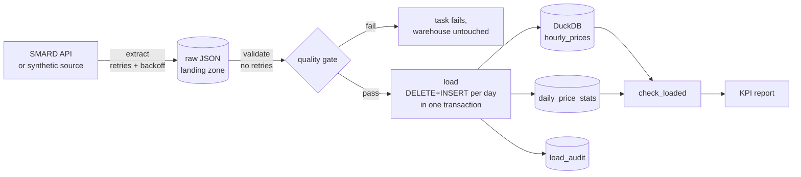

# airflow-energy-price-pipeline

Airflow 3 DAG that loads German day-ahead electricity prices (SMARD format) into DuckDB every day. Loads are idempotent, daylight-saving days are handled correctly, and a quality gate stops bad data before it reaches the warehouse.

[](https://github.com/SurajKumarrrrr/airflow-energy-price-pipeline/actions/workflows/ci.yml)

> **Data note:** the demo and all tests use a **deterministic synthetic generator** that copies the
> SMARD API's format and the rough shape of German prices (seasonality, solar dip, negative
> weekend hours). The numbers below come from that synthetic data and are **not real market
> facts**. The real SMARD API source is included (`--source smard`) and unit-tested against
> mocked responses. It was not run here because the build sandbox has no internet access.

## Problem

Energy traders, utilities and analysts need a clean, complete hourly price history for the
German/Luxembourg bidding zone. Any daily feed raises the same practical questions:

- **Re-runs:** retries, backfills or a manually cleared Airflow task must never create duplicate rows.
- **Time zones:** a delivery day is defined in Europe/Berlin and has 23, 24 or 25 hours.
- **Bad upstream data:** missing hours, nulls or out-of-range prices must not reach the warehouse unnoticed.
- **Scheduling:** the auction for day D+1 is published around 12:45 on day D, so each run has to load the right day.

## Approach



| Layer | What it does |
|---|---|
| `sources.py` | `SmardHttpSource` reads SMARD's weekly chunk files (filter 4169, DE-LU), with retries and exponential backoff. `SyntheticSmardSource` generates the same format offline, seeded per date. |
| `extract.py` | Lands the raw payload at `raw/<source>/delivery_date=YYYY-MM-DD.json` using an atomic write (temp file + rename). A re-run overwrites the file. |
| `transform.py` | Converts to typed records and checks completeness (23/24/25 h), duplicates, nulls, full-hour alignment, the delivery-day window and the SDAC price limits [-500, 4000] EUR/MWh. |
| `load.py` | Deletes and re-inserts one `delivery_date` partition inside one DuckDB transaction, and rebuilds that day's aggregates (base, EEX peak Mon–Fri 08–20 h, off-peak, spread, negative hours). Every load is written to `load_audit`. |
| `dags/energy_price_dag.py` | Thin TaskFlow DAG: `extract → validate → load → check_loaded`. Runs at `30 13 * * *` Berlin time, `max_active_runs=1` (DuckDB allows one writer), and accepts a `delivery_date` param for manual runs. |
| `__main__.py` | CLI (`run`, `backfill`, `report`) that uses **the same functions** as the DAG. |

## Results

Produced by `make run` (synthetic data, full year 2025, about 17 s on a laptop-class CPU):

1. **Backfill with one injected fault** (`--drop-hour-on 2025-08-14`): 365 days → **364 loaded, 1 failed_quality**
   (`2025-08-14: expected 24 hours, got 23 distinct`). The bad day never reached the warehouse.
2. **Full re-run of the same year:** 365/365 loaded. 8,736 existing rows were replaced, not duplicated.
   The previously failed day was filled in by the re-run.
3. **Warehouse health after both runs** (from `reports/summary.md`):

| hourly_rows | days_loaded | 23-hour days | 25-hour days | duplicate_rows | load_runs (audit) |
|---|---|---|---|---|---|
| 8,760 | 365 | 1 (30 Mar) | 1 (26 Oct) | **0** | 729 |

Example KPIs from the synthetic year (EUR/MWh). These show the reporting layer working; they do not describe the real market:

| month | base avg | peak avg | avg intraday spread | negative hours |
|---|---|---|---|---|
| 2025-01 | 113.91 | 120.41 | 84.17 | 0 |
| 2025-06 | 52.80 | 49.58 | 145.89 | 81 |
| 2025-12 | 101.59 | 107.47 | 74.77 | 0 |

The year averages 80.45 base and 82.08 peak, with 329 negative-price hours, which are concentrated on
weekends (1.55 negative hours per weekend day vs 0.64 per weekday). The hourly profile has its low
at 13:00 (29.72) and its high at 19:00 (124.94). This is the "duck curve" the generator was built to produce.

**Airflow check:** the DAG was run end to end with `airflow dags test energy_day_ahead_prices 2025-06-10T11:30:00+00:00`
on Apache Airflow 3.1.8. All 4 tasks succeeded. As designed, the run scheduled on 10 June loaded delivery
day **2025-06-11** (24 rows, base 79.27, peak 78.38). The test suite has **32 tests**. The DAG integrity
test runs in a separate CI job that installs Airflow.

## How to run

```bash
make install          # duckdb, pytest, ruff
make test             # 31 tests; the DAG test is skipped without Airflow
make run              # full-year backfill + fault injection + re-run + reports/summary.md
```

Single day or custom range:

```bash
export PYTHONPATH=src
python -m energy_pipeline run --date 2025-03-30            # DST day -> 23 rows
python -m energy_pipeline backfill --start 2025-01-01 --end 2025-01-31
python -m energy_pipeline report --out reports/summary.md
PYTHONPATH=src python scripts/download_data.py --start 2025-01-01 --end 2025-01-31   # real SMARD data (internet)
```

Airflow (local, single container, standalone mode):

```bash
docker compose up --build   # UI on http://localhost:8080, the admin password is printed in the container log
# trigger a specific day: Trigger DAG -> params {"delivery_date": "2025-06-11"}
```

The Docker setup follows the official `apache/airflow` image conventions but was not built in the
sandbox. The DAG itself was tested with a pip-installed Airflow 3.1.8 (see Results).

Configuration uses environment variables: `ENERGY_SOURCE` (`synthetic` | `smard`), `ENERGY_DATA_DIR`,
`ENERGY_RAW_DIR` and `ENERGY_DB_PATH`.

## Project structure

```
├── dags/energy_price_dag.py      # Airflow 3 TaskFlow DAG (wiring only)
├── src/energy_pipeline/
│   ├── timeutils.py              # Berlin delivery days, DST, run -> delivery-date mapping
│   ├── sources.py                # SMARD HTTP source + deterministic synthetic source
│   ├── extract.py                # raw landing zone, atomic writes
│   ├── transform.py              # typed records + quality checks
│   ├── load.py                   # DuckDB DDL, idempotent partition upsert, aggregates, audit
│   ├── pipeline.py               # orchestration-agnostic steps used by DAG and CLI
│   ├── report.py                 # KPI SQL + Markdown report
│   └── __main__.py               # CLI
├── tests/                        # 32 pytest tests (DST, idempotency, rollback, retries, DAG integrity)
├── scripts/download_data.py      # real SMARD backfill
├── Dockerfile, docker-compose.yml
└── .github/workflows/ci.yml      # ruff + pytest, plus a DAG-import job with Airflow
```

## What I'd do next

- Switch to SMARD's quarter-hourly resolution (the day-ahead market moved to 15-minute products in Oct 2025) and store `resolution` as a column.
- Use Postgres as the warehouse (or a MotherDuck/S3 Parquet layout) so several DAG runs can write in parallel.
- Add Airflow Assets so a downstream forecasting DAG triggers as soon as a new day lands.
- Alert on the `check_loaded` task (Slack/Teams webhook) and add a freshness SLA ("tomorrow's prices loaded by 14:30").
- Add more sources (ENTSO-E Transparency, generation mix) and join them with prices for analysis.

## Interview notes

- **Idempotency by partition overwrite:** each run owns exactly one `delivery_date`. It deletes and re-inserts that day inside one transaction, so retries, backfills and cleared tasks can't create duplicates. Tests prove that a re-run gives identical row counts and that a failed insert rolls back.
- **Time zones are a correctness problem:** I store UTC, derive the Berlin delivery day, and expect 23/25 hours on DST days. The fall-back day has local hour 2 twice, which is why `ts_utc` is the primary key and `local_hour` is not.
- **Retry policy per task:** `extract` retries with exponential backoff because network failures are transient. `validate` has `retries=0` because a missing hour won't fix itself in 5 minutes. It should fail loudly while the warehouse stays untouched.
- **Thin DAG, testable core:** all logic is plain Python, so 31 tests run without Airflow. The DAG file only wires tasks together, and one integrity test checks the DAG imports and its dependency graph.
- **Scheduling semantics:** the 13:30 run on day D loads delivery day D+1 (`delivery_date_for_run`). Manual runs can override this with a param, and history is loaded with the same code path through the CLI or `airflow backfill create`.
