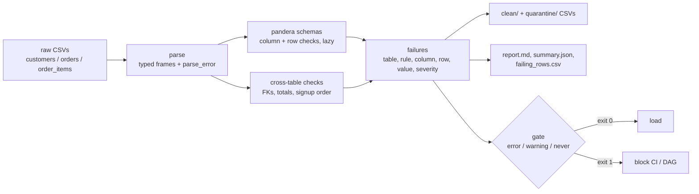

# data-quality-pandera-checks

[](https://github.com/SurajKumarrrrr/data-quality-pandera-checks/actions/workflows/ci.yml)

A reusable data-quality layer for batch pipelines: declarative table contracts compiled to
**pandera** schemas, cross-table checks, row-level quarantine, failing-row reports and a
**CI gate** that blocks bad data the same way a failing unit test blocks bad code.

## Problem

Most pipeline incidents are data incidents, not code incidents: a source system starts
sending `"Germany"` instead of `"DE"`, an export duplicates customer IDs, a total no longer
matches its line items. Typical ad-hoc `assert` statements fail on the first problem, tell
you nothing about *which rows* are affected and either let everything through or stop
everything.

What a data team needs instead:

- **All** violations in one run, with the exact row, column and offending value.
- A distinction between **errors** (row must not reach the warehouse) and **warnings**
  (row is loaded, but someone should look).
- Clean rows keep flowing; bad rows are **quarantined** with a reason.
- A machine-readable result that a CI job or orchestrator can use as a **gate**.
- Evidence that the checks actually catch what they claim to catch.

## Approach



**Rule catalogue (`rules.py`).** Every rule has one name, one severity and one description.
24 rules: 21 errors, 3 warnings. The report, the gate and the docs all read from here.

**Contracts (`contracts.py`).** A `TableContract` declares columns, logical types,
nullability, primary key and named checks, and compiles itself to a
`pandera.DataFrameSchema`. Pandera does lazy validation and failure-case collection; the
contract keeps rule names stable and the schemas easy to read in a code review.

**Parse before validate (`parsing.py`).** Pandera's own coercion gives up on a column at the
first bad value and then every later check on that column fails with a `TypeError`. Parsing
first with `errors="coerce"` reports each bad cell once as `parse_error` and still runs all
the other checks on the remaining values. Missing and unexpected columns become failures
instead of crashes.

**Cross-table checks (`relations.py`).** Things a single-table schema cannot express:
referential integrity (`orders.customer_id`, `order_items.order_id`), order total equals
the sum of its line items (±0.01), and "order placed before signup" as a warning.

**Quarantine + gate (`validate.py`).** Rows with any error-severity failure go to
`quarantine/` with a `dq_reasons` column; everything else, including warning-only rows, goes
to `clean/`. `gate_passed("error" | "warning" | "never")` turns the result into an exit code.

**Measured detection (`generate.py`, `evaluate.py`).** The generator first builds a clean
dataset that satisfies every contract, then injects 18 labelled defect types into disjoint
rows and writes a `defects.csv` manifest. `evaluate` checks that each injected defect was
caught *by the rule it was designed to violate* and that no unlabelled row was flagged.

## Results

All data is **synthetic** (deterministic generator, seed 42, 500 customers). The numbers
below show that the validation layer behaves as designed on that data; they are not
statistics about any real shop.

`make run` (3 defects per type, 57 injected defects incl. both rows of each duplicate key):

| table       | rows  | clean | quarantined | rows with warnings | pass rate |
|-------------|------:|------:|------------:|-------------------:|----------:|
| customers   |   503 |   485 |          18 |                  3 |    96.42% |
| orders      | 1,174 | 1,153 |          21 |                  3 |    98.21% |
| order_items | 2,970 | 2,961 |           9 |                  3 |    99.70% |

- **51 error failures, 9 warning failures** → gate `error`: **FAILED** (exit 1).
- **57 / 57 injected defects detected** by their intended rule (recall 1.0 for all 18 defect
  types), **0 flags on unlabelled rows**.
- Clean dataset (`--clean`, 500 customers / 1,174 orders / 2,967 items): **0 failures**,
  gate passes even in the strictest `--fail-on warning` mode.
- Cascades are visible, not hidden: the 3 `negative_total` orders also fail
  `total_matches_items` (6 failures for that rule), because a negated total no longer
  matches its items.
- Scale check on the sandbox machine: 20,000 customers / 49,982 orders / 124,860 items
  (194,845 rows) validated in **0.89 s** in-process, ~1.9 s for the full CLI run including
  reading CSVs and writing all reports.

Excerpt of the generated `reports/report.md`:

| table | rule | severity | failures | rows | examples |
|---|---|---|---|---|---|
| customers | unique_key | error | 6 | 6 | customer_id=103, customer_id=162, customer_id=215 |
| customers | valid_country | error | 3 | 3 | de, Germany, XX |
| orders | parse_error | error | 3 | 3 | 31.02.2025 10:00, yesterday, 2025-13-01 |
| orders | total_matches_items | error | 6 | 6 | 141.39 vs items 123.39, -48.21 vs items 48.21, … |
| order_items | price_plausible | warning | 3 | 3 | 4999.0 |

## How to run

```bash
make install        # pip install -r requirements.txt && pip install -e .
make test           # 33 pytest tests
make run            # generate defective data -> validate -> score detection
make gate           # clean data must pass, defective data must be blocked

# or directly
dq-checks generate --out data/raw --customers 500 --defects-per-type 3
dq-checks validate --data-dir data/raw --out-dir reports --as-of 2026-01-01 --fail-on error
dq-checks evaluate --data-dir data/raw --out-dir reports
```

Outputs in `reports/`: `report.md`, `summary.json`, `failing_rows.csv`, `detection.csv`,
`clean/*.csv`, `quarantine/*.csv`. In CI the reports are uploaded as a build artifact.

## Project structure

```
src/dq_checks/
  rules.py       rule catalogue: name -> severity + description
  contracts.py   TableContract -> pandera.DataFrameSchema for the 3 tables
  parsing.py     typed parsing, parse_error / missing_column / unexpected_column
  relations.py   foreign keys, order totals, order-after-signup
  validate.py    orchestration, failure normalisation, quarantine split, gate
  report.py      markdown / JSON / CSV artefacts
  generate.py    deterministic synthetic data + labelled defect injection
  evaluate.py    detection recall against the defect manifest
  cli.py         dq-checks generate | validate | evaluate
tests/           parsing, single-rule, cross-table, generator/recall and CLI tests
.github/workflows/ci.yml   ruff + pytest + data-quality gate
```

## What I'd do next

- Load contracts from YAML so analysts can add rules without touching Python.
- Run the same contracts on Parquet in object storage and on Polars/Spark frames (pandera
  supports both backends).
- Persist `summary.json` per run into a table to track pass rates and alert on drift
  (e.g. volume drop or a rule suddenly failing for >1% of rows).
- Wire `validate` as a task in an Airflow/Dagster DAG between extract and load.
- Statistical checks (distribution shift against the previous load) as warnings.

## Interview notes

- **Why parse before pandera?** Coercion inside pandera stops at the first bad value per
  column, and later checks then fail with `TypeError`s. A separate parse step reports each
  unparseable cell exactly once and lets every other rule still run, and I suppress the
  follow-up `not_nullable` for the same cell to avoid double counting.
- **Errors vs warnings, quarantine vs stop.** Stopping the whole load for three bad rows out
  of 4,600 hurts downstream users more than it helps. Error rows are quarantined with
  reasons, warning rows are loaded and reported, and the gate decides whether the run as a
  whole is acceptable.
- **Testing the tests.** Labelled defect injection gives ground truth: I can say that all
  57 injected defects were caught by the intended rule and that nothing else was flagged,
  instead of "I wrote some checks". It also caught a real bug during development: setting
  pandera's `error=` message replaced the check name in `failure_cases`, which broke the
  severity mapping and dropped recall to 18/57 until I fixed it.
- **Determinism.** The `as_of` date is a parameter, not `now()`, so "no future dates" gives
  the same answer in CI today and next year; the generator uses fixed seeds.
- **Frame-level checks.** Pandera reports a row-wise check once per column; I collapse those
  to one failure per row and describe it by the primary key (`order_id=100124`), which is
  what someone fixing the source data actually needs.
