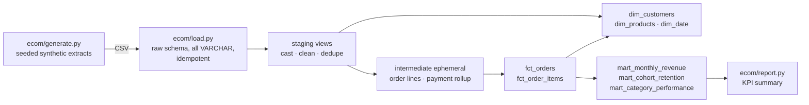

# dbt-duckdb-ecommerce-analytics

An analytics-engineering project in dbt on DuckDB. It takes messy raw shop extracts through a tested **raw → staging → star schema → reporting marts** pipeline, and `dbt build` runs it with one command.

[](https://github.com/SurajKumarrrrr/dbt-duckdb-ecommerce-analytics/actions/workflows/ci.yml)

> **Data note:** all data comes from a seeded synthetic generator (`ecom/generate.py`, seed 42). It is shaped like a real
> DACH online shop, but the numbers below describe the simulation. They are not findings about a real business.

## Problem

Source systems deliver data that you can't report on straight away. Money arrives as integer cents and timestamps as
strings. E-mail and country codes come in mixed case. The extractor re-delivers an order every time its status changes,
so the same order shows up more than once. Payments live in a separate system that also records failed attempts and
refunds. Analysts need one trusted model on top of all this, so that "revenue", "AOV" or "retention" mean the same
thing in every dashboard, and they need tests that catch a broken definition before it reaches management.

## Approach



* **ELT, not ETL.** `load.py` lands every column as `VARCHAR` with an `_ingested_at` stamp and applies no logic. All
  typing and cleaning lives in version-controlled, tested SQL.
* **Staging** (`stg_shop__*`, views): casting, `trim`/`lower`/`upper` normalisation, cents → exact `DECIMAL` euros through
  a `cents_to_eur` macro, a `parse_bool` macro, and deduplication of re-delivered orders with
  `row_number() over (partition by order_id order by _loaded_at desc)`.
* **Intermediate** (ephemeral): order lines priced and costed, plus payment events rolled up per order (paid, refunded,
  failed attempts, first successful method).
* **Marts** (tables, `main_marts` schema): a Kimball-style star with `fct_orders` (grain: order), `fct_order_items`
  (grain: order line), `dim_customers` (lifetime metrics plus a rule-based segment), `dim_products` and a generated
  `dim_date`. Three reporting marts sit on top for monthly KPIs, cohort retention and category performance.
* **Revenue definition:** `net_revenue = successful payments − refunds`. A "revenue order" is one that is placed,
  shipped or delivered. Cancelled and returned orders count toward the rates, not toward revenue.
* **67 data tests:** `unique`, `not_null`, `relationships` (FK integrity across the star), `accepted_values`, a custom
  generic `non_negative` test, and four singular business tests:
  * every non-cancelled order was paid exactly *items − discounts + shipping*
  * no order is dated before the customer signed up
  * the monthly mart reconciles to the order fact to the cent
  * dedup keeps exactly one row per source order
* **Python around dbt:** `pipeline.py` calls dbt through its programmatic `dbtRunner` API, so one command, the tests and
  CI all exercise the same path.

## Results

These numbers come from `python -m ecom.pipeline` with the default config (5,000 customers, 250 products,
2024-01 to 2025-12, seed 42). **They describe synthetic data.**

**Pipeline**

| Table | Raw rows |
|---|---|
| customers | 5,000 |
| products | 250 |
| orders (incl. re-deliveries) | 9,948 |
| order_items | 23,824 |
| payments | 10,703 |

* Staging dedup collapsed 9,948 raw order rows into **9,504 unique orders**, removing 444 re-delivered versions.
* `dbt build`: 15 models and 67 data tests, **PASS=80, ERROR=0**, in about 2.2 s on a laptop-class CPU.
* 1,168 raw customer rows needed e-mail or country normalisation.

**KPIs (simulated)**

| Orders | Revenue orders | Net revenue | AOV | Return rate | Cancel rate |
|---|---|---|---|---|---|
| 9,504 | 8,393 | €2,741,003.71 | €326.58 | 6.71 % | 4.98 % |

* Net revenue was €1.14 M in 2024 and €1.60 M in 2025, because the customer base builds up over the simulation.
* The top month is **2025-11** (€158.3 k, 586 orders). This comes from the Q4 seasonality built into the generator.
* Electronics brings the most revenue (€802 k) at the lowest margin (35.8 %). Beauty has the highest margin (43.4 %).

| Category | Net revenue | Gross margin % | Return rate % |
|---|---|---|---|
| Electronics | €802,475 | 35.8 | 6.7 |
| Sports | €674,897 | 36.6 | 6.3 |
| Fashion | €550,780 | 41.6 | 6.7 |
| Home & Kitchen | €311,857 | 36.3 | 7.2 |
| Beauty | €269,344 | 43.4 | 7.5 |
| Books | €127,727 | 40.5 | 7.9 |

* Customer segments: "repeat" customers (2–3 orders, 1,618 people) and "loyal" customers (4+ orders, 694 people) bring
  **81.2 %** of net revenue. 979 registered customers (about 20 %) never ordered.
* Average cohort retention is 17.6 % in month 1, 15.3 % in month 3 and 11.2 % in month 6.

## How to run

```bash
make install        # pip install -r requirements.txt  (Python 3.11+)
make run            # generate → load → dbt build → print KPI report
make test           # pytest: generator, loader, and a full dbt build on a small dataset
make lint           # ruff
make docs           # dbt docs generate + serve (lineage graph in the browser)
```

To run dbt by hand:

```bash
cd dbt_project
export DUCKDB_PATH=../warehouse.duckdb
dbt build --profiles-dir .
dbt build --profiles-dir . --select +fct_orders   # one model and its upstream models
```

You can explore the warehouse with any DuckDB client: `duckdb warehouse.duckdb "from main_marts.mart_monthly_revenue"`.

## Project structure

```
├── ecom/
│   ├── generate.py        # seeded synthetic source extracts (messy on purpose)
│   ├── load.py            # EL: CSV → raw schema (VARCHAR, idempotent)
│   ├── pipeline.py        # one-command runner, calls dbt via dbtRunner
│   └── report.py          # KPI queries on the marts
├── dbt_project/
│   ├── dbt_project.yml    # layer configs: staging=view, intermediate=ephemeral, marts=table
│   ├── profiles.yml       # DuckDB target, path from $DUCKDB_PATH
│   ├── macros/            # cents_to_eur, parse_bool
│   ├── models/
│   │   ├── staging/       # sources + stg_shop__* + tests
│   │   ├── intermediate/  # int_order_items_enriched, int_order_payments
│   │   └── marts/         # facts, dims, reporting marts + tests
│   └── tests/             # singular business tests + generic non_negative test
├── tests/                 # pytest (unit + dbt integration)
├── .github/workflows/ci.yml
├── Makefile · requirements.txt · pyproject.toml
```

## What I'd do next

* Make `fct_orders` an **incremental** model (`unique_key='order_id'`, merging on `_loaded_at`) and add a **snapshot**
  of customers so country and opt-in history is kept as SCD Type 2.
* Add `dbt-expectations` or `dbt_utils` for distribution tests, e.g. alerting when daily order volume drifts by more
  than 3σ, and set source freshness thresholds on `_ingested_at`.
* Define revenue and AOV once in the dbt **Semantic Layer / MetricFlow**, so BI tools stop re-implementing them.
* Swap the target for MotherDuck or Postgres in `profiles.yml`. The models are adapter-agnostic, apart from a few DuckDB
  conveniences (`arg_min`, `filter`).
* Add slim CI: `dbt build --select state:modified+` against the production manifest.

## Interview notes

* **Why ELT with an all-VARCHAR raw layer?** Raw stays a faithful copy of the source, so I can reprocess history
  whenever a business rule changes. Every transformation is reviewed, tested SQL in git rather than hidden in a
  loader script.
* **Materialisation choices:** staging models are cheap views, intermediate models are ephemeral CTEs (reusable logic
  without extra tables), and marts are tables because dashboards query them. On a larger dataset `fct_orders` would
  become incremental.
* **Grain first:** each fact table has its grain written down and enforced with a `unique` test, and FK
  `relationships` tests guarantee the star joins cleanly. Most bad dashboards come from fan-out on a mis-stated grain.
* **Tests encode business rules, not just schema:** the singular test that compares payments with *items − discounts
  + shipping* would catch a pricing or shipping-fee bug that every schema test would pass.
* **Money as DECIMAL, never float:** amounts arrive as integer cents and become `DECIMAL(14,2)` in one macro, and the
  monthly mart reconciles to the fact table to the cent.
