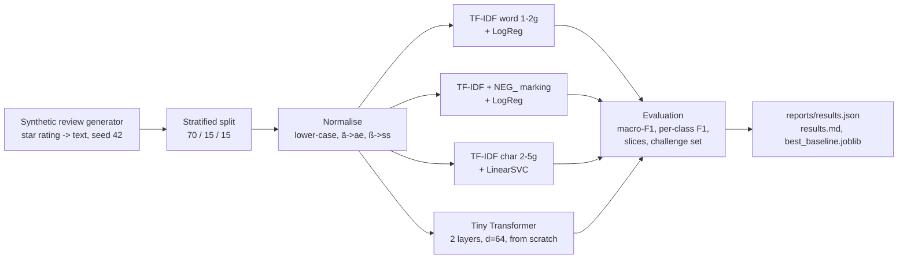

# German Review Sentiment NLP

Three-class sentiment classification (negativ / neutral / positiv) for German product reviews,
comparing TF-IDF baselines with a small Transformer trained from scratch in PyTorch, with
slice-based evaluation and an out-of-distribution challenge set.

[](https://github.com/SurajKumarrrrr/german-review-sentiment-nlp/actions/workflows/ci.yml)

> **Data disclaimer:** the training and test data are **synthetic**, generated
> deterministically (seed 42) by `src/gersent/data.py`. The 30-sentence challenge set was
> written by hand. None of the numbers below describe real customer behaviour. They compare
> *methods* on a controlled dataset.

## Problem

German shops, marketplaces and support teams receive thousands of free-text reviews.
Star ratings are noisy, and the text holds the actual reason. A useful classifier has to
handle what makes German hard for simple models:

- **Negation**: *"nicht schlecht"* is positive, *"kann ich nicht empfehlen"* is negative
- **Contrast**: in *"Lieferung schnell, aber der Akku ist enttäuschend"* the clause after *aber* decides
- **Neutral and mixed 3-star reviews**: the minority class that matters most for product teams
- **Spelling noise**: *"Verhaeltnis"* instead of *"Verhältnis"*, typos, all lower-case

The question: **does a small Transformer beat well-engineered TF-IDF baselines, and what does it cost?**

## Approach



- **Data generator** (`data.py`): a star rating is drawn from a J-shaped distribution like
  real shops (40 % five-star), then a review is composed from aspect clauses for six product
  categories (headphones, coffee machines, vacuum cleaners, running shoes, smartphones,
  drills). It includes negated clauses, *aber/doch* contrast clauses, neutral 3-star reviews,
  umlaut transliteration (12 %), character-swap typos (15 %) and **3 % label noise**, so
  text and stars sometimes disagree.
- **Labels**: 1–2 stars → negativ, 3 → neutral, 4–5 → positiv.
- **Baselines** (`baselines.py`): scikit-learn pipelines with `class_weight="balanced"`.
  The negation variant adds a `NEG_` prefix to every token after a negation cue (*nicht, kein,
  nie, ohne, …*) until punctuation or *aber/doch* (`text.py`).
- **Tiny Transformer** (`transformer.py`): word-level vocabulary, `[CLS]` token, learned
  positional embeddings, 2 pre-norm encoder layers (4 heads), class-weighted cross-entropy,
  AdamW, early stopping on validation macro-F1. 91,267 parameters.
- **Evaluation** (`evaluate.py`): accuracy, macro-F1 (the main metric, because classes are
  imbalanced), per-class F1, confusion matrix, macro-F1 on slices (negation, contrast,
  transliterated umlauts) and accuracy on a **hand-written challenge set** of 30 reviews.
  The challenge set uses different wording than the generator.

## Results

Output of `make run` (6,000 reviews: 4,200 train / 900 val / 900 test; labels 3,523 positiv,
1,713 negativ, 764 neutral). Baselines train on train+val, and the Transformer uses val for
early stopping. Timings are from a CPU-only cloud sandbox.

| Model | Test accuracy | Test macro-F1 | F1 neutral | Challenge acc. (n=30) | Train time (s) | Inference (ms/review) |
|---|---|---|---|---|---|---|
| majority_class | 0.587 | 0.246 | 0.000 | 0.400 | 0.1 | 0.010 |
| tfidf_word_lr | 0.952 | 0.929 | 0.858 | 0.700 | 0.3 | 0.031 |
| tfidf_word_negation_lr | 0.953 | 0.931 | 0.863 | 0.767 | 0.3 | 0.032 |
| tfidf_char_svm | 0.953 | **0.934** | 0.875 | 0.767 | 1.6 | 0.186 |
| tiny_transformer | 0.947 | 0.932 | **0.901** | 0.400 | 105.5 | 0.395 |

Macro-F1 on test slices:

| Model | with_negation | with_contrast | transliterated_umlauts |
|---|---|---|---|
| tfidf_word_lr | 0.932 (n=715) | 0.936 (n=429) | 0.931 (n=66) |
| tfidf_word_negation_lr | 0.935 (n=715) | 0.942 (n=429) | 0.931 (n=66) |
| tfidf_char_svm | 0.938 (n=715) | 0.936 (n=429) | 0.958 (n=66) |
| tiny_transformer | 0.934 (n=715) | 0.922 (n=429) | 0.965 (n=66) |

What this shows (on synthetic data):

1. **All four models are within 0.5 macro-F1 points of each other on the in-distribution
   test set** (0.929–0.934). With 3 % label noise the ceiling is about 97–98 % accuracy, so
   the remaining gap is small. The Transformer takes 65–350× longer to train and is ~12× slower
   at inference than the word baselines, and it buys nothing here.
2. **The Transformer has the best neutral-class F1 (0.901 vs 0.858–0.875)**, but it
   misclassifies more positive reviews as negative (21 vs 5–6 of 528). Macro-F1 hides that
   trade-off, and the confusion matrix in `reports/results.json` shows it.
3. **Negation marking helps a little on the test set but clearly on new wording**: challenge
   accuracy rises from 0.700 to 0.767 (23 vs 21 of 30). The two reviews it fixes are
   *"Keine Ahnung, warum das so gute Bewertungen hat. Enttäuschend."* and
   *"Nie wieder! Der Support ist eine Katastrophe."*
4. **Character n-grams handle spelling noise best among the baselines** (0.958 on the
   transliterated slice), as expected for typos and *ae/ä* variants.
5. **The from-scratch Transformer does not generalise**: 0.400 on the challenge set, which
   only equals the majority-class baseline. It learned the generator's vocabulary, and a
   word-level vocabulary maps most new words to `[UNK]`. This is the practical argument for
   **pre-trained** German models (see `scripts/finetune_pretrained.py`) and for subword
   tokenisation. Note the small sample: n=30 gives a 95 % CI of roughly ±15 points.

## How to run

```bash
make install        # or: make install-cpu  (smaller CPU-only PyTorch wheel)
make lint test      # ruff + 25 pytest tests, ~10 s
make run            # full experiment, ~2 min on CPU -> reports/
PYTHONPATH=src python -m gersent predict "Der Akku ist nicht schlecht." \
    "Sieht gut aus, aber der Akku ist schwach. Schicke ich zurück."
# positiv  | Der Akku ist nicht schlecht.
# negativ  | Sieht gut aus, aber der Akku ist schwach. Schicke ich zurück.
make data           # optional: write the synthetic dataset to data/reviews.csv
```

Optional, needs internet and is not part of CI. It fine-tunes a pre-trained German model on
the same split (no results are claimed for it here):

```bash
pip install "transformers>=4.40,<5"
PYTHONPATH=src python scripts/finetune_pretrained.py --model distilbert-base-german-cased
```

## Project structure

```
├── src/gersent/
│   ├── data.py          # deterministic synthetic review generator + stratified split
│   ├── text.py          # normalisation, tokenisation, negation scope marking
│   ├── baselines.py     # TF-IDF pipelines (word, word+negation, char) + majority class
│   ├── vocab.py         # word vocabulary for the Transformer
│   ├── transformer.py   # tiny Transformer encoder + training loop with early stopping
│   ├── evaluate.py      # metrics, slice metrics, error examples
│   ├── pipeline.py      # end-to-end experiment, writes reports/
│   └── cli.py           # gersent generate | run | predict
├── challenge/challenge_set.csv   # 30 hand-written reviews, tagged by phenomenon
├── scripts/finetune_pretrained.py
├── tests/               # pytest: text, data, models, pipeline/CLI
├── .github/workflows/ci.yml
├── Makefile, pyproject.toml, requirements.txt
```

## What I'd do next

- Fine-tune a pre-trained German encoder (e.g. `distilbert-base-german-cased`, GBERT) and
  report it in the same table, ideally on a real, licensable German review dataset.
- Replace the word vocabulary with a subword tokenizer (BPE/WordPiece) to fix the OOV
  problem that sinks the from-scratch Transformer on new wording.
- Grow the challenge set to a few hundred labelled examples per phenomenon, then use it
  as a regression test in CI (a "behavioural test suite" in the style of CheckList).
- Calibrate probabilities and add an "uncertain → human review" threshold for the neutral class.
- Serve the best baseline behind FastAPI, because at 0.03 ms per review it is the cheap option.

## Interview notes

- **Baselines first.** A tuned TF-IDF + logistic regression model trains in 0.3 s and matched
  the Transformer on the test set. I'd only accept a slower model if it wins on a metric the
  business cares about, such as neutral-class recall.
- **Macro-F1, not accuracy.** The majority-class model scores 58.7 % accuracy and 0.246
  macro-F1. With imbalanced classes, accuracy hides a failing minority class.
- **Slice and challenge-set evaluation catch what one test score hides.** The Transformer
  looked as good as the baselines in-distribution and collapsed on new wording. I'd make
  this kind of out-of-distribution check part of the model's acceptance criteria.
- **Domain knowledge as features.** Negation scope marking is a few lines of code and
  improved generalisation (0.700 → 0.767 challenge accuracy). It is also easy to explain to
  stakeholders, unlike attention weights.
- **Leakage awareness.** Splits are stratified and disjoint. Baselines use train+val
  because they have no early stopping. I also removed generator phrases from the challenge
  set so it measures generalisation, not memorisation.
