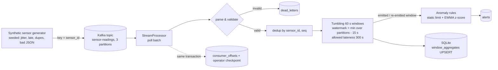

# kafka-sensor-streaming-pipeline

Event-time stream processing of IoT sensor data on Kafka: tumbling windows, per-partition watermarks, late-data handling, a dead-letter queue, streaming anomaly alerts, and crash-safe, effectively-once output to SQLite.


> **Data note:** all sensor data here is **synthetic**. It comes from a seeded generator that simulates 12 machines on three made-up sites (labelled Frankfurt, Offenbach and Darmstadt). The numbers below show how well the *pipeline* works. They say nothing about real machines.

## Problem

Sensor streams are messy. Messages arrive out of order, devices buffer data while offline and flush it minutes later, producers retry and create duplicates, and some payloads are broken. A naive consumer that groups by *arrival* time and auto-commits offsets will produce wrong aggregates, double-count retries, and lose or duplicate results when it crashes.

The goal is a small but correct stream processor that:

1. aggregates readings into 1-minute windows per sensor by **event time**,
2. handles out-of-order, late, duplicate and malformed messages explicitly,
3. raises overheating alerts while the incident is still happening, and
4. produces exactly the same output table whether or not the consumer crashes halfway.

## Approach



Key design choices:

- **The broker sits behind an interface.** The processor only knows the small `Source` / `Producer` protocols. `KafkaSourceAdapter` uses `kafka-python` against the docker-compose cluster, and `InMemoryBroker` (partitioned, offset-addressable logs) runs the same code in tests and in the offline demo.
- **Event time and watermarks.** Each partition tracks the highest event time it has seen. The watermark is the *minimum* across partitions minus a 15 s out-of-orderness bound, so one fast partition can't close windows that a slower partition still has data for. This is the Flink / Kafka Streams model in about 150 lines.
- **Late data is handled in three tiers.** Out-of-order events within 15 s are included normally. Events up to 300 s late update a window that was already emitted, which is re-emitted and upserted (its `revision` goes up). Anything later is counted and dropped.
- **Effectively-once output.** Window results, alerts, dead letters, the next offsets *and* a snapshot of operator state (open windows, dedup keys, watermarks, anomaly baselines) are written in **one SQLite transaction**. On restart the processor seeks to the stored offsets and restores its state. Window rows are upserted by `(sensor_id, window_start)`, so replaying a batch changes nothing. Kafka's own offset commit is deliberately not used.
- **Explainable alerts.** A static limit (max temperature over 75 °C) is compared with a per-sensor EWMA baseline z-score. Anomalous windows are kept out of the baseline so that an ongoing incident doesn't slowly become "normal".

## Results

From `make run` (seed 42, 2 simulated hours, 12 sensors at 5 s intervals, 3 partitions, consumer crash simulated after 15 batches and then resumed). Every row compares the streaming output against a pandas batch ground truth built from the clean, de-duplicated readings.

| Metric | Value |
|---|---|
| Messages produced (incl. 164 duplicates, 34 malformed) | 17,478 |
| Records processed before crash / after restart | 7,500 / 9,978 |
| Malformed messages routed to the dead-letter table | 34 / 34 |
| Duplicates detected and dropped | 164 / 164 |
| Late events (74 injected, 180–600 s late) that updated an emitted window | 22 |
| Late events beyond the 300 s allowed lateness (dropped) | 21 |
| Windows produced vs. expected | 1,440 / 1,440 |
| Windows exactly equal to the batch ground truth | **98.6 %** (the 20 that differ are each missing a too-late event; max mean error 0.12 °C) |
| Output with crash + resume vs. without crash | **identical** (row-by-row comparison) |
| Throughput, in-memory broker incl. per-batch SQLite commit (single CPU core in a cloud sandbox; varies by machine) | ~13,000 msgs/s |

Overheating detection against the 4 injected incidents (60 incident windows):

| Rule | Alerts | Precision | Recall | Incidents caught | Mean event time → alert |
|---|---|---|---|---|---|
| Static threshold (> 75 °C) | 17 | 0.94 | 0.27 | 2 / 4 | 446 s |
| EWMA z-score (z > 5) | 63 | 0.95 | **1.00** | **4 / 4** | **60 s** |

The fixed threshold misses the machines that normally run cool. The per-sensor baseline catches every incident in the first window that closes after it starts. The 3 z-score "false positives" are windows at the edges of an incident that only partly overlap it.

These figures come from synthetic data and a single seed. They show the pipeline behaves correctly. They are not a benchmark of real sensor behaviour.

## How to run

Offline (no Kafka needed):

```bash
make install
make test        # ruff + pytest live in CI as well
make run         # generate -> produce -> consume (with simulated crash) -> evaluate, prints JSON
```

With a real Kafka broker (KRaft single node, requires Docker):

```bash
make up          # kafka + topic creation + producer (120x real time) + processor
sqlite3 data/sensors.db "SELECT * FROM alerts LIMIT 10;"
make down
```

You can also point the CLI at any broker yourself: `python -m sensorstream produce --bootstrap localhost:29092` and `python -m sensorstream consume --bootstrap localhost:29092 --db data/sensors.db`.

The docker-compose setup is included for local use but is **not** exercised in CI. CI runs lint plus the full test suite against the in-memory broker, which drives the same processing code.

## Project structure

```
src/sensorstream/
  models.py      # SensorReading schema, JSON serde, validation -> InvalidMessage
  generator.py   # seeded synthetic stream with jitter, late data, dupes, bad payloads, incidents
  broker.py      # Source/Producer protocols, InMemoryBroker, kafka-python adapters
  windowing.py   # event-time tumbling windows, watermarks, allowed lateness, dedup, snapshots
  anomaly.py     # static threshold + EWMA z-score rules
  sink.py        # SQLite schema, transactional commit of results + offsets + state
  pipeline.py    # StreamProcessor: poll -> validate -> window -> detect -> commit; resume
  evaluate.py    # streaming output vs batch ground truth, alert precision/recall
  cli.py         # run (offline) / produce / consume
tests/           # 33 tests: windows, watermarks, late data, dedup, crash-resume, idempotency
docker-compose.yml, Dockerfile
```

## What I'd do next

- Handle idle partitions (advance the watermark after a timeout when a partition stops sending) so one silent sensor group can't stall all output.
- Replace SQLite with PostgreSQL or TimescaleDB and use Kafka transactions (`read_committed`) for an end-to-end exactly-once sink in Kafka.
- Add a schema registry (Avro or Protobuf) and route the dead-letter queue to its own Kafka topic.
- Run the same logic in Flink or Spark Structured Streaming and compare the results with this reference implementation.
- Expose consumer lag, late-event rate and alert counts as Prometheus metrics.

## Interview notes

- **Why event time?** Arrival time depends on the network and on device buffering. Grouping by it puts readings in the wrong minute. Event time plus a watermark keeps the results deterministic and independent of delivery order, and the crash-resume test proves this.
- **Why the minimum watermark across partitions?** Partitions are consumed at different speeds. Taking the max would close windows while a lagging partition still holds their data. The min is safe. Its cost is that one idle partition can stall output, which is a known trade-off with known fixes.
- **How do you get exactly-once without Kafka transactions?** Store the offsets and the operator state in the *same* database transaction as the results, and make the writes idempotent (upsert by key). A crash then means replaying at most one uncommitted batch, and that replay is harmless.
- **What about late data?** It's a latency versus completeness trade-off. Results are emitted quickly at the watermark, corrected for up to 5 minutes (tracked with a `revision` column), and anything later is counted rather than silently lost. Here that kept 98.6 % of windows exactly correct.
- **Why two alert rules?** A fixed threshold is easy to explain but ignores how different machines are. The per-sensor EWMA baseline caught 4/4 incidents compared with 2/4, and freezing the baseline during an anomaly stops the incident from "teaching" the model that it is normal.
