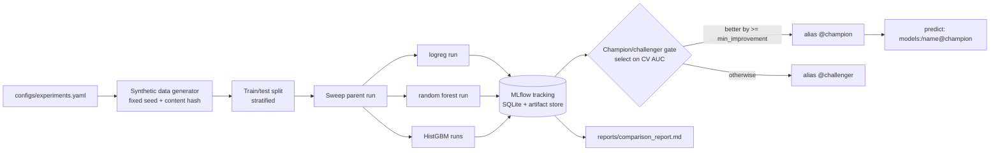

# mlflow-experiment-tracking

Config-driven, reproducible model training with **MLflow**: every run is tracked with params, metrics, artifacts and data/config fingerprints, the winner goes into the **model registry** behind a champion/challenger gate, and a comparison report is generated straight from the tracking store.


## Problem

In many teams "the best model" lives in a notebook cell nobody can rerun. Typical questions nobody can answer afterwards:

- Which data and which hyperparameters produced the model in production?
- Did the new model actually beat the old one, or did someone just overwrite it?
- Can I get the same numbers again tomorrow?

This project shows a small but complete answer: experiments are defined in YAML, every training run is logged to MLflow, and a new model only becomes `@champion` if it beats the current one by a configured margin.

## Approach



- **Config, not code**: `configs/experiments.yaml` lists candidates (model family + hyperparameters), seed, primary metric and the promotion margin. The config is validated (unknown models, duplicate names, bad split sizes fail fast) and hashed into a `config_fingerprint`.
- **Data**: a deterministic **synthetic** credit-default dataset (6,000 applicants, 11 features, 14.5 % default rate) with non-linear effects and an interaction. The dataset is hashed (`data_fingerprint`) so every run records exactly which data it saw.
- **Pipelines**: each candidate is a full scikit-learn `Pipeline` (scaling/one-hot for logistic regression, ordinal encoding + native categorical support for trees), so the logged model includes its preprocessing and can be served on raw rows.
- **Tracking** (one nested run per candidate under a parent "sweep" run):
  - params: model family, hyperparameters, seed, split sizes
  - metrics: 5-fold CV ROC-AUC (mean, std and per-fold history), test ROC-AUC, PR-AUC, F1, accuracy, Brier score, log loss, train-test overfit gap, fit time
  - tags: git commit, sklearn/Python versions, data and config fingerprints
  - artifacts: model with signature + input example, confusion matrix, permutation importance, candidate params
- **Selection without test leakage**: the winner is chosen on **cross-validated AUC on the training folds**; the test set is only used for reporting.
- **Registry**: the best run of a sweep is registered as a new version and tagged with its score and the gate decision. MLflow **aliases** (`@champion`, `@challenger`) are used instead of the deprecated stages. Promotion is a pure, unit-tested function (`should_promote`).
- **Report**: `reports/comparison_report.md` is built by querying MLflow (`search_runs`), not from in-memory state, so it reflects what was actually logged.

## Results

Produced by `make run` on the bundled config (synthetic data, seed 42, 4,500 train / 1,500 test rows). **The data is synthetic; these numbers describe this generated dataset, not real credit risk.**

| candidate | model | CV AUC (5-fold) | CV std | test AUC | test PR-AUC | test Brier | train-test AUC gap |
|---|---|---|---|---|---|---|---|
| **logreg_strong_reg** (C=0.05) | logistic regression | **0.7823** | 0.0115 | 0.7545 | 0.4355 | 0.1036 | 0.035 |
| logreg_baseline (C=1.0) | logistic regression | 0.7821 | 0.0118 | 0.7525 | 0.4326 | 0.1041 | 0.037 |
| random_forest | random forest | 0.7609 | 0.0100 | 0.7408 | 0.4408 | 0.1046 | 0.149 |
| hist_gbm_shallow | HistGradientBoosting | 0.7347 | 0.0205 | 0.7323 | 0.4234 | 0.1072 | 0.238 |
| hist_gbm | HistGradientBoosting | 0.7180 | 0.0160 | 0.7241 | 0.3945 | 0.1115 | 0.276 |

(Test-set base rate is 14.5 %, so a random model would have PR-AUC ≈ 0.145.)

Registry behaviour, from two consecutive runs:

1. First run: `credit-default-classifier` **v1** (`logreg_strong_reg`) registered and promoted to `@champion` ("no champion yet").
2. Identical rerun: same metrics to the last decimal (reproducibility), **v2** registered but kept as `@challenger` only: "delta +0.0000 below required 0.002".

Other observations from the logged artifacts:

- The strongly regularised logistic regression wins. The tree ensembles fit the training data much better (AUC gap 0.15–0.28) but generalise worse; the gap metric makes this visible directly in the MLflow UI.
- Permutation importance of the champion (test AUC drop): `late_payments_12m` 0.025, `loan_amount_k_eur` 0.015, `debt_to_income` 0.014, `loan_term_months` 0.012; `loan_purpose` and `employment_type` are close to zero.
- At the default 0.5 threshold the champion catches only 46 of 217 defaults (confusion matrix TP 46 / FN 171 / FP 22). The ranking quality is decent but the threshold needs to be chosen from business costs (see next steps).

## How to run

```bash
make install        # pip install -r requirements.txt (Python 3.11+)
make test           # 29 tests, including end-to-end runs against a temporary MLflow store
make run            # train all candidates, register/gate, write report, score 5 new rows
make ui             # browse runs and registry at http://localhost:5000
```

Single steps:

```bash
PYTHONPATH=src python -m mlflow_tracking.cli train --config configs/experiments.yaml
PYTHONPATH=src python -m mlflow_tracking.cli predict -n 10
# remote tracking server instead of local SQLite:
PYTHONPATH=src python -m mlflow_tracking.cli --tracking-uri http://mlflow:5000 train
```

Running `make run` twice demonstrates the gate: the second sweep registers a new version that does not get promoted.

## Project structure

```
configs/experiments.yaml        experiment definition (candidates, seed, metric, gate margin)
src/mlflow_tracking/
  config.py                     typed + validated config, config fingerprint
  data.py                       deterministic synthetic dataset, dataset fingerprint
  models.py                     candidate -> sklearn Pipeline factory
  tracking.py                   tracking URI / experiment / artifact-location setup
  train.py                      sweep with nested runs: CV, metrics, artifacts, model logging
  registry.py                   register best run, champion/challenger gate, load @champion
  report.py                     markdown comparison report from search_runs
  cli.py                        train / predict / all
tests/                          unit tests + integration tests on a temp SQLite store
reports/                        generated report (git-ignored)
```

## What I'd do next

- Choose the decision threshold from a cost matrix (missed default vs. rejected good customer) and log it with the model.
- Add a calibration step (`CalibratedClassifierCV`) and track calibration curves as artifacts.
- Hyperparameter search with Optuna, logging each trial as a nested run.
- Run the tracking server with PostgreSQL + S3/MinIO via docker-compose, and promote models from CI instead of locally.
- Compare champion vs. challenger on a fresh data slice (not the challenger's own CV score) before promotion.

## Interview notes

- **Why a database backend?** The MLflow model registry needs a SQL store; the default `./mlruns` file store can't do aliases or versions. SQLite locally, PostgreSQL in production is a one-line change of `--tracking-uri`.
- **Selection on CV, not test**: picking the model with the best test score and then reporting that score is optimistic. The gate uses 5-fold CV AUC on the training data; the test set stays an honest final estimate.
- **Reproducibility is logged, not promised**: every run carries seed, git commit, library versions, a config hash and a data content hash. The test suite asserts that two runs with the same config produce identical metrics.
- **Aliases over stages**: MLflow deprecated `Staging/Production` stages. `@champion` / `@challenger` aliases let serving code load `models:/name@champion` without knowing version numbers, and rollback is just moving the alias.
- **Simple models can win**: the logistic regression beat boosted trees here because the data is mostly additive and the trees overfit; tracking the train-test gap made that visible immediately instead of trusting the more complex model by default.
