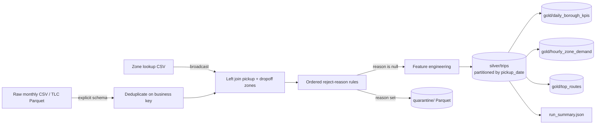

# pyspark-batch-taxi-processing

A PySpark batch job that turns raw NYC-TLC-style taxi trip files into a validated, partitioned
Parquet table and three analytics-ready aggregates, with a quarantine for bad records.

[](https://github.com/SurajKumarrrrr/pyspark-batch-taxi-processing/actions/workflows/ci.yml)

> **Data note:** the default run uses a **synthetic**, deterministically generated dataset
> (fixed seed) in the format of the public NYC TLC yellow-taxi files. The numbers below
> describe that synthetic data and the job's behaviour, not real New York traffic.
> `scripts/download_data.py` fetches an official TLC month if you want to run on real data.

## Problem

Trip-record feeds like the NYC TLC files arrive as large monthly dumps with the usual
problems: re-delivered duplicates, negative fares, zero-distance trips, drop-offs before
pick-ups, unknown location IDs. Analysts need a clean, partitioned table plus daily KPIs, and
the data team needs to know *what* was thrown away and *why* — not just a smaller row count.

## Approach



- **Explicit schemas** (`schema.py`) for both CSV and Parquet input. Official TLC Parquet stores
  `passenger_count` as double, so the reader casts to one canonical raw schema.
- **Deduplication** on a business key (`VendorID`, pick-up/drop-off timestamps, locations).
- **Broadcast left joins** to the zone table: no shuffle of the trip table, and unknown IDs stay
  visible (an inner join would drop them silently). A test asserts the plan contains a
  `BroadcastHashJoin`.
- **Ordered validation rules** produce one `reject_reason` per row (first match wins), then the
  data is split into silver and quarantine — every input row ends up in exactly one place.
- **Features**: duration, average speed, pick-up date/hour, weekend flag, time-of-day bucket,
  tip share (card payments only — cash tips aren't recorded), airport flag.
- **Gold tables**: daily KPIs per borough (incl. `percentile_approx` median duration), hourly
  demand per zone normalised by the number of weekdays/weekend days, and top-5 routes per
  borough via a `row_number()` window with deterministic tie-breaking.
- **Spark tuning for a single machine**: 8 shuffle partitions instead of 200, AQE on, session
  time zone pinned to UTC, silver cached because three aggregates reuse it,
  `repartition("pickup_date")` before `partitionBy` so each date is one file, and dynamic
  partition overwrite so re-runs are idempotent.

## Results

From `make run` (150,000 generated rows, 90 days Jan–Mar 2025, `local[*]`, Spark 4.x on a
cloud sandbox):

| Metric | Value |
|---|---|
| Raw rows read | 150,000 |
| Duplicates removed | 1,507 (1.0%) |
| Valid rows → silver | 145,578 |
| Quarantined rows | 2,915 (1.96% of de-duplicated rows) |
| Silver partitions (`pickup_date=`) | 90, one Parquet file each |
| Wall-clock job time | 24.2 s |

Row counts reconcile exactly: 150,000 − 1,507 = 145,578 + 2,915.

Quarantine breakdown (the generator injects these defects at known rates, so this checks the
rules catch them):

| reject_reason | rows |
|---|---|
| invalid_distance | 864 |
| invalid_passenger_count | 706 |
| non_positive_duration | 470 |
| negative_amount | 453 |
| unknown_zone | 280 |
| duration_too_long | 142 |

Headline numbers from the gold tables (synthetic data):

| Pickup borough | Trips | Revenue ($) | Avg fare ($) | Avg card tip % |
|---|---|---|---|---|
| Manhattan | 125,516 | 3,304,490 | 20.61 | 20.0 |
| Queens | 9,509 | 730,060 | 62.62 | 20.1 |
| Brooklyn | 6,113 | 295,590 | 39.92 | 19.8 |
| EWR | 2,963 | 268,044 | 73.29 | 20.0 |
| Bronx | 981 | 47,720 | 40.30 | 19.8 |
| Staten Island | 496 | 24,145 | 40.43 | 19.7 |

- Airport trips are 11.6% of trips but 33.6% of revenue.
- Average speed is lowest in the morning peak (9.8 mph) and highest at night (15.7 mph).
- The busiest hour is weekdays 18:00 (≈107 pick-ups per weekday across all zones).

These patterns were built into the generator; the point is that the pipeline recovers them
correctly, not that they are discoveries about New York.

## How to run

Requires Python 3.11+ and Java 17+ (for Spark).

```bash
make install        # pip install -r requirements.txt
make test           # 34 pytest tests (chispa DataFrame comparisons + end-to-end run)
make run            # generate 150k synthetic trips, run the job, print the report
make run ROWS=20000 # smaller run (what CI does)
make clean
```

Outputs land in `data/output/` (`silver/`, `quarantine/`, `gold/`, `run_summary.json`).

Real TLC data:

```bash
python scripts/download_data.py --month 2024-01
PYTHONPATH=src python -m taxi_batch.job --format parquet \
  --input data/tlc/yellow_tripdata_2024-01.parquet \
  --zones data/tlc/taxi_zone_lookup.csv --output data/output_tlc
```

## Project structure

```
├── src/taxi_batch/
│   ├── spark.py        # SparkSession factory (shuffle partitions, AQE, UTC)
│   ├── schema.py       # explicit raw + zone schemas, business key
│   ├── storage.py      # CSV/Parquet readers, partitioned Parquet writer
│   ├── transforms.py   # pure DataFrame transforms: dedupe, joins, rules, features, gold
│   ├── generate.py     # deterministic synthetic TLC-style data with injected defects
│   └── job.py          # wires the pipeline, writes outputs, run summary + report
├── data/reference/taxi_zones.csv   # 40-zone lookup in TLC format
├── scripts/download_data.py        # optional: official TLC month + zone lookup
├── tests/              # unit tests per transform + end-to-end + idempotency
├── .github/workflows/ci.yml        # ruff + pytest + smoke run on Java 17
└── Makefile
```

The bundled zone file is a 40-zone subset modelled on the official TLC lookup; use the
downloaded `taxi_zone_lookup.csv` for real data.

## What I'd do next

- Write silver as Delta Lake / Iceberg for MERGE-based incremental loads and time travel.
- Add a `--date` argument to process one day at a time from an orchestrator (Airflow) and
  benchmark against full-refresh.
- Replace the hand-written rules with a declarative data-quality layer (e.g. pandera or
  Great Expectations) and fail the job when the quarantine rate exceeds a threshold.
- Run on the real 2024 TLC year on a small cluster (Databricks / EMR) and tune file sizes and
  skew (the Manhattan-heavy distribution is a natural skew test).

## Interview notes

- **Why separate transforms from I/O?** Every step is a pure `DataFrame → DataFrame` function,
  so I can unit-test it with three hand-built rows and `chispa` instead of files. The job module
  just wires them together.
- **Quarantine over filter:** dropping bad rows hides problems upstream. An ordered rule chain
  gives each rejected row exactly one reason, and the counts reconcile to the input, which makes
  the job auditable.
- **Broadcast left join:** the zone table is tiny, so broadcasting avoids a shuffle of the big
  table; "left" keeps unknown IDs so they're quarantined rather than silently lost. I assert the
  physical plan in a test so a future change can't regress it unnoticed.
- **Partitioning and small files:** `repartition("pickup_date")` before `partitionBy` gives one
  file per date instead of (tasks × dates) tiny files; dynamic partition overwrite makes
  re-running a period idempotent, which a test checks.
- **Time zones bit me:** the first test run was off by one hour because PySpark converts naive
  Python datetimes using the local time zone. I pinned the session to UTC and made test
  timestamps timezone-aware.
