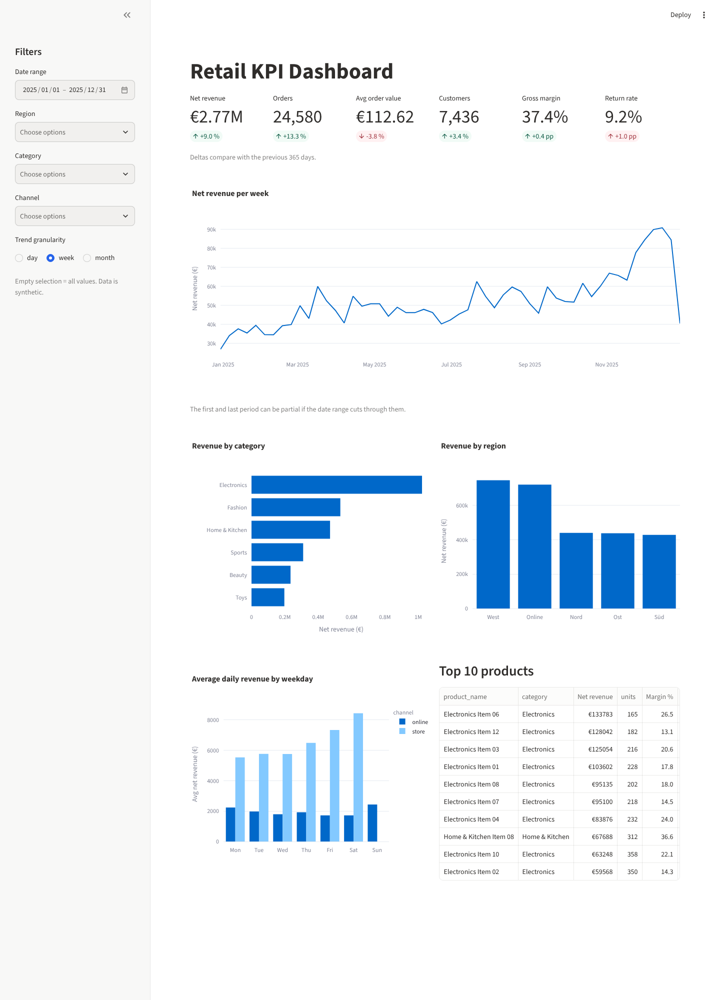
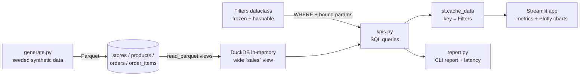

# Retail KPI Dashboard (Streamlit + DuckDB)

Interactive sales-KPI dashboard for a multi-channel retailer: filter by date, region, category and channel, and every KPI, chart and period-over-period delta updates from parameterised DuckDB SQL behind a Streamlit cache.

[](https://github.com/SurajKumarrrrr/streamlit-retail-kpi-dashboard/actions/workflows/ci.yml)



> **Data note:** all data is **synthetic**, produced by a seeded generator (`src/retail_kpi/generate.py`) for a fictional German retailer with 9 stores and a webshop. Seasonality, growth and return rates are modelling assumptions. The numbers below describe the generated data, not any real company or market.

## Problem

Business teams want answers like "how did online Fashion do this quarter compared with last quarter?" without waiting for an analyst to write a query. A useful self-service dashboard needs:

- KPI definitions that are **explicit and consistent** (what exactly is "revenue" when items are returned?)
- filters that **cannot break or inject into** the SQL
- fast responses on repeated interactions
- tests, so a refactor doesn't silently change a number a manager reports upwards

## Approach



- **Storage / engine:** Parquet files exposed as DuckDB views (no load step, filters pushed into the scan). One wide `sales` view joins the star schema and defines `gross_revenue`, `net_revenue` and `net_cost` in exactly one place.
- **KPI definitions** (in `kpis.py`):
  - net revenue = line value after discount, excluding returned lines; gross revenue includes them
  - AOV = net revenue / distinct orders
  - gross margin = (net revenue − cost of kept items) / net revenue
  - return rate = returned value / gross value (value-based, not line-count-based)
  - deltas compare against the **previous period of equal length**; percentage KPIs are compared in percentage points
- **Safe filtering:** `Filters.to_sql()` only ever emits `?` placeholders; values are bound by DuckDB. Identifiers that can't be parameters (trend grain, breakdown dimension) are checked against whitelists.
- **Caching:** `st.cache_resource` holds one DuckDB connection per server process (each query uses its own cursor); `st.cache_data(ttl=600)` caches each query result keyed by the frozen `Filters` dataclass, so revisiting a filter combination doesn't hit the database.
- **Testing:** a 5-line hand-built dataset where every KPI is computed by hand in the test docstring, generator determinism/integrity tests, and a headless UI test with Streamlit's `AppTest` that clicks a filter and checks the metric changes.

## Results

Output of `make report` (seed 42, full year 2025 vs. 2024, synthetic data):

| KPI (2025) | Value | vs. 2024 |
|---|---:|---:|
| Net revenue | €2,768,316 | +9.0 % |
| Orders | 24,580 | +13.3 % |
| Customers | 7,436 | +3.4 % |
| Avg order value | €112.62 | −3.8 % |
| Gross margin | 37.38 % | +0.42 pp |
| Return rate (by value) | 9.19 % | +0.97 pp |

| Category | Net revenue share | Margin | Return rate |
|---|---:|---:|---:|
| Electronics | 37.0 % | 18.6 % | 8.9 % |
| Fashion | 19.3 % | 54.4 % | 18.3 % |
| Home & Kitchen | 17.0 % | 40.4 % | 4.9 % |
| Sports | 11.2 % | 43.1 % | 6.4 % |
| Beauty | 8.5 % | 58.6 % | 2.8 % |
| Toys | 7.1 % | 47.5 % | 4.0 % |

What the dashboard surfaces in this generated dataset:

- Orders grew faster (+13.3 %) than net revenue (+9.0 %), so **AOV fell 3.8 %**, a typical "volume up, basket down" pattern worth a drill-down.
- Electronics brings 37 % of revenue at only 18.6 % margin, while Fashion has the highest return rate (18.3 %). Revenue rank and profit rank differ, which is why the dashboard shows margin and returns next to revenue.
- The webshop is 26 % of revenue but returns **14.5 %** of its gross value vs. 7.2 % for stores (the generator assumes online returns are about twice as likely).
- Strong year-end seasonality: December is the peak month (€390k), February the lowest (€144k).

Performance: one full uncached dashboard refresh (all 7 KPI/chart queries, including the previous-period comparison) over **82,968 order lines** takes a median **~101 ms** with no filters and **~89 ms** with three filters active (measured with `time.perf_counter` in `report.py` in a cloud sandbox; your machine will differ). Repeat interactions are served from `st.cache_data`.

Tests: **30 passed**, `ruff check .` clean.

## How to run

```bash
make install    # pip install -r requirements.txt
make run        # generates data/ on first run, then: streamlit run app.py
make report     # same KPIs as text + query latency
make test       # pytest
make lint       # ruff
```

Without `make`: `pip install -r requirements.txt && streamlit run app.py` (the app generates its data if `data/` is missing). Point `RETAIL_KPI_DATA_DIR` at another folder with the same four Parquet tables to use different data.

## Project structure

```
├── app.py                     # Streamlit UI: sidebar filters, metrics, Plotly charts, cache wrappers
├── src/retail_kpi/
│   ├── generate.py            # seeded synthetic data → Parquet (stores, products, orders, order_items)
│   ├── db.py                  # DuckDB connection, Parquet views, wide `sales` view, filter options
│   ├── filters.py             # frozen Filters dataclass → parameterised WHERE, previous period
│   ├── kpis.py                # KPI summary, deltas, trend, top products, breakdowns, weekday profile
│   ├── formatting.py          # metric labels (€2.77M, +9.0 %)
│   └── report.py              # CLI report + latency measurement
├── tests/                     # hand-computed KPI fixture, generator, filters, formatting, AppTest UI
├── docs/dashboard.png         # screenshot of the running app
├── .streamlit/config.toml
├── .github/workflows/ci.yml   # ruff + pytest
├── Makefile · requirements.txt · pyproject.toml
```

## What I'd do next

- Swap the Parquet source for a warehouse (Postgres/BigQuery) behind the same `kpis.py` interface and add a dbt layer for the `sales` model.
- Add drill-through: click a category bar to filter the rest of the page.
- Target lines and alerts (e.g. return rate above threshold) and a downloadable CSV of the filtered data.
- Authentication and row-level security per region manager.
- Deploy to Streamlit Community Cloud or a container on Cloud Run.

## Interview notes

- **One definition per metric.** Revenue, net revenue and cost are defined once in the `sales` view; every chart reuses them, so the KPI tile and the category chart can't disagree. Returns are handled explicitly because "revenue" is ambiguous otherwise.
- **SQL injection by design, not by luck.** Filter values are always bound parameters; the two things that can't be parameters (date-trunc grain, group-by column) go through whitelists, and there are tests that try to inject.
- **Why a frozen dataclass for filters:** it is hashable, so Streamlit can use it directly as the cache key, and `previous_period()` gives a clean, testable way to compute period-over-period deltas.
- **Why DuckDB views over Parquet:** zero load step, columnar scans with predicate pushdown, and ~100 ms for a full refresh on ~83k lines, with no server to run. The same SQL would port to a warehouse.
- **Testing a dashboard:** KPI logic is tested against a tiny dataset with hand-computed answers (including edge cases: no rows, no baseline, 100 % returns), and the UI is smoke-tested headlessly with `AppTest`, which also runs in CI.
